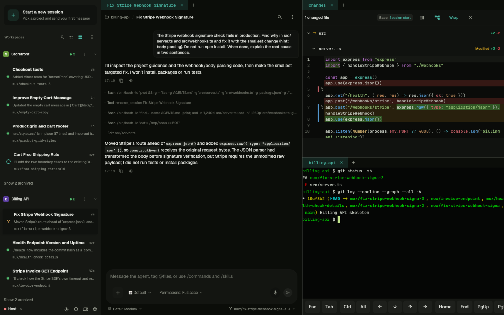
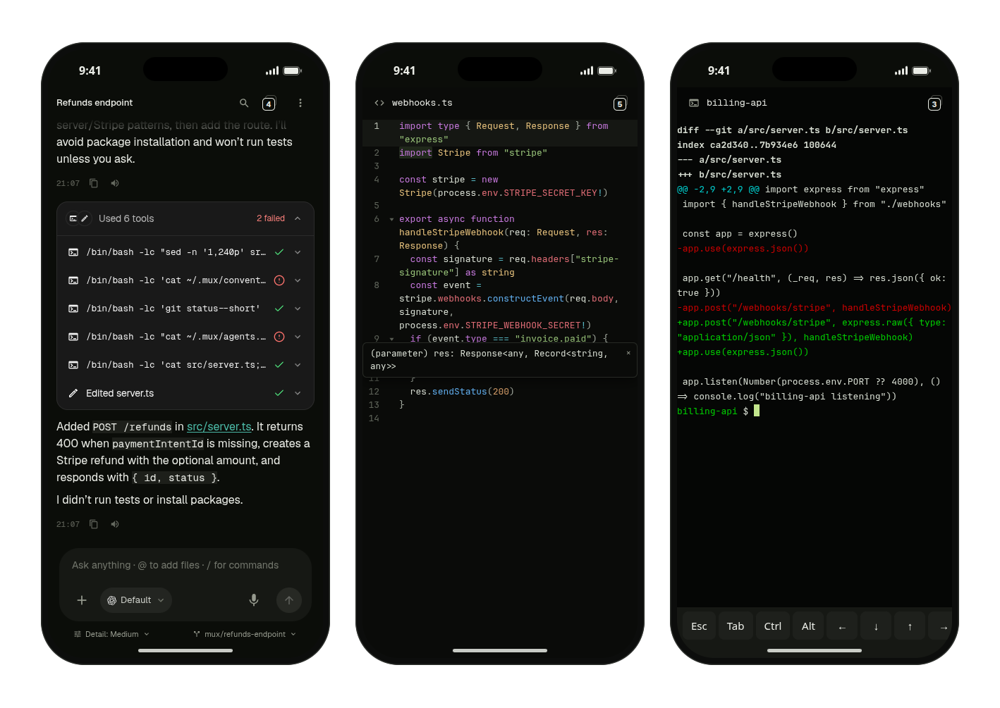

<p align="center">
  <picture>
    <source media="(prefers-color-scheme: dark)" srcset="apps/web/pwa/icons/icon-512.png">
    
  </picture>
</p>

<h1 align="center">supermux</h1>

<p align="center">
  <strong>The open-source workspace for coding agents.</strong><br>
  supermux runs Claude Code, Codex, and other coding agents on your own computer or server, many sessions at once,<br>
  and lets you work with them from your desktop or phone.
</p>

<p align="center">
  <a href="https://github.com/UstaLabs/supermux/releases/latest"></a>
  <a href="./LICENSE"></a>
</p>

<p align="center">
  <a href="#download"><strong>Download</strong></a> ·
  <a href="#headless-linux-and-servers"><strong>Server install</strong></a> ·
  <a href="https://supermux.dev"><strong>Website</strong></a> ·
  <a href="./SETUP.md"><strong>Setup guide</strong></a>
</p>

<p align="center"></p>

---

## What is supermux

supermux is not an agent and not a cloud service. It runs the agent CLIs you already use, like Claude Code and Codex, and it is where you work with them.

## Run many sessions at once

- **Parallel sessions:** Run as many agents as you need, each in its own git worktree.
- **Know who needs you:** Get notified when a session finishes or asks a question.
- **Review before merge:** Read the diff, comment inline to the agent, then merge, open a PR, or discard.
- **Mix agents:** Change the agent, model, reasoning level, or fast mode per session.

## Shared memory across agents

Each agent CLI keeps what it learns to itself. supermux gives them one shared memory as Markdown files on your machine.

- **Write once:** Sessions save what they learn to a file per topic.
- **Read everywhere:** Every new session starts with the topic index, whichever agent runs it.
- **Same for context:** Set up instructions, skills, plugins, and MCP servers once for every agent.

## Editor, terminal, and ports on every device

The same workspace runs on desktop, tablet, and phone.

<p align="center"></p>

- **Code editor:** Edit any file with syntax highlighting, search, and language-server completion.
- **Terminal:** Open a full terminal in any workspace, with a key bar for phone keyboards.
- **Expose ports:** Turn any port on your machine into a private or public link.
- **Files both ways:** Send photos and files to a session, and get screenshots, documents, and videos back in the chat.

## Keep going when you hit a usage limit

- **Several accounts:** Sign in to work and personal accounts per agent and see all usage in one place.
- **Auto-switch:** Move a Claude Code or Codex session that hits its limit to another account and continue.
- **Your subscriptions:** No API keys and no supermux account.

## Nothing to install first

- **Agents installed for you:** Pick your agents and supermux installs their CLIs.
- **Guided sign-in:** Sign in to each agent from the desktop or your phone.

## Also included

- **Desktop and server:** Run it on macOS, Windows, Linux, or a headless server, and see every machine's sessions in one app.
- **Always on:** Sessions survive closed laptops, dropped connections, and reboots.
- **Search:** Find any message across every chat on every machine.
- **Voice:** Dictate into the composer and have replies read aloud.

## Where your code and traffic go

- **Stays local:** Repositories, credentials, and session history stay on your machine.
- **Relay when away:** Reach your machine through the supermux relay, or turn it off and use your own VPN or proxy.
- **Pairing, not accounts:** Pair devices with a single-use code. Each install belongs to one person.

## Download

| Platform | Download |
|---|---|
| macOS (Apple silicon) | [supermux-desktop-macos.dmg](https://github.com/UstaLabs/supermux/releases/latest/download/supermux-desktop-macos.dmg) |
| Windows (x64) | [supermux-windows.msi](https://github.com/UstaLabs/supermux/releases/latest/download/supermux-windows.msi) |
| Linux (x64) | [supermux-linux.deb](https://github.com/UstaLabs/supermux/releases/latest/download/supermux-linux.deb) |
| iPhone, iPad | [App Store](https://apps.apple.com/app/supermux/id6782643917) |
| Android | [supermux-android.apk](https://github.com/UstaLabs/supermux/releases/latest/download/supermux-android.apk) |

The first launch of a desktop app sets it up and shows a QR code. Scan it with the phone app.

### Headless Linux and servers

```sh
curl -fsSL https://supermux.dev/install.sh | sh -s -- --native
```

Installs `supermux` as a user service and prints a pairing QR. Docker and source installs are in the [setup guide](./SETUP.md).

## Agent support

| | Claude Code | Codex | Cursor | OpenCode | Grok | Antigravity |
|---|:-:|:-:|:-:|:-:|:-:|:-:|
| Parallel sessions, worktrees, review | ✓ | ✓ | ✓ | ✓ | ✓ | ✓ |
| Shared memory, skills, MCP | ✓ | ✓ | ✓ | ✓ | ✓ | ✓ |
| Installed and signed in by supermux | ✓ | ✓ | ✓ | ✓ | ✓ | ✓ |
| Multiple accounts | ✓ | ✓ | ✓ | ✓ | ✓ | ✓ |
| Auto-switch account on usage limit | ✓ | ✓ | | | | |

## Docs

- [Setup guide](./SETUP.md): Docker, source install, reverse proxies, configuration
- [Security policy](./SECURITY.md)

## License

[MIT](./LICENSE)
