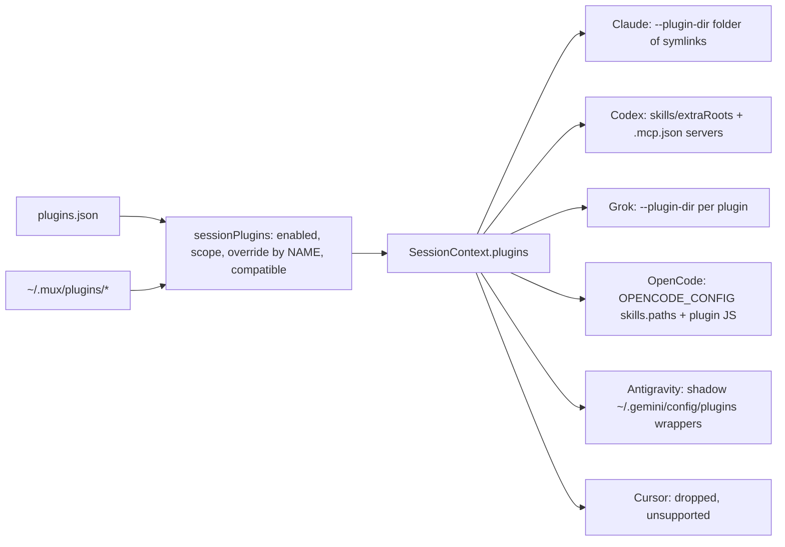

# Plugin and skill sharing: how one plugin reaches six agents (2026-11-07, card #102)

A plugin is a folder. The broker decides which folders a session gets; supermux-core turns each folder into
whatever that agent can load. Nothing is installed into an agent's own home and nothing is written into a
workdir: every generated file lives in the session's state.

## The pieces

| Piece | File | What it does |
|---|---|---|
| Plugin trees | `~/.mux/plugins/<name>/` | `skills/<skill>/SKILL.md`, optional `.claude-plugin/`, `.codex-plugin/`, `.cursor-plugin/` manifests, `.mcp.json`, `.opencode/plugins/*.js`, `hooks/`, `commands/`, `agents/` |
| Registry | `~/.mux/plugins.json`, `src/core/plugins/registry.ts` | `{ name, source, enabled, scopes: AgentKind[], perSessionOverrides: { <session name>: { enabled } } }`. A malformed file yields no plugins, never a failed spawn. |
| Boot sync | `src/main.ts` (before `resumeAtBoot`), `src/core/plugins/mux-core.ts`, `src/core/plugins/index.ts` | Writes the first-party `mux-core` plugin (manifests and an empty `skills/`; no OpenCode JS plugin since #102), registers it for all six agents, then, once per registry (recorded in `migrations`), adds `opencode`, `grok` and `antigravity` to every enabled plugin those agents can read. |
| Selection | `sessionPlugins(agent, sessionName)` in `src/core/plugins/index.ts` | Enabled, scoped to the agent, not switched off for the session's name, compatible (`isPluginCompatible`). Run in every agent's `prepare`, i.e. on every launch (create, resume, wake). |
| Hand-off | `src/core/agents/<agent>/core-host.ts` | `context.plugins = sessionPlugins(...)`, policy `warn`: what an agent cannot load is dropped with `context.degraded`, never refused. |
| Mapping | `packages/supermux-core/src/context/agents.ts`, `context/plugins.ts`, `environment/antigravity.ts` | Per-agent channel, below. Writes only into the core's per-session context folder (or Antigravity's shadow HOME). |
| How to use a skill | `src/core/agents/agent-header.ts` `SKILL_LOADING` | The one per-agent line of the session instructions. |
| Lifecycle | `src/core/plugins/lifecycle.ts` | `add/update/remove/setPluginEnabled/listPlugins`. **No caller**: no UI, no CLI, no API. `session.updateContext` (live add/remove) has no caller in the broker either. |

## Per agent

| Agent | Compatible when | Channel | Skill name the agent shows | How the agent loads it | Live change (per code; nothing calls it yet) |
|---|---|---|---|---|---|
| Claude | `.claude-plugin/plugin.json` | `--plugin-dir <ctx>/plugins` (`NN-<name>` symlinks) | `m102probe:zephyr-quokka-check` | `Skill` tool | live (`reload_plugins`) |
| Codex | `.codex-plugin/plugin.json` | `skills/extraRoots/set` with each plugin's `skills/`; `.mcp.json` stdio servers as `-c mcp_servers.*` | `m102probe:zephyr-quokka-check` | reads `SKILL.md` with the shell | live for skills-only plugins |
| Grok | has `skills/*/SKILL.md` | `grok agent --plugin-dir <ctx>/plugins/NN-<name>` per plugin | `zephyr-quokka-check` | `Read_file` on `SKILL.md` | relaunch |
| OpenCode | `skills/` trees or `.opencode/plugins/*.js` | session `OPENCODE_CONFIG`: `skills.paths` (+ the global paths), `plugin: [file://…js]`; `.mcp.json` → ACP `mcpServers` | `zephyr-quokka-check` | native `skill` tool | relaunch |
| Antigravity | `skills/` trees or `.mcp.json` | generated `supermux-<name>` wrappers in the session's shadow `~/.gemini/config/plugins`, servers in the shadow `mcp_config.json` | `zephyr-quokka-check` | reads `SKILL.md` | relaunch |
| Cursor | `.cursor-plugin/plugin.json` | **none**: `cursor-agent acp` ignores `--plugin-dir`; the core drops plugins and skills | not listed | n/a, and its instructions have no SKILLS line | n/a |

Claude loads the whole plugin folder (hooks, `commands/`, `agents/` too). Grok gets the folder too; what it does
with those parts was not tested. Codex, OpenCode and Antigravity map skills and stdio MCP servers only and drop the
rest with `context.degraded`.

## Scopes and per-session overrides

- `scopes` is read on every launch, so an edit of `plugins.json` reaches each session's next launch without a
  restart.
- The boot scope additions (`ensureOpenCodePluginScopes`, `ensureGrokPluginScopes`, `ensureAntigravityPluginScopes`)
  are a one-time migration per agent kind, recorded in `plugins.json` as `migrations: ["scope:opencode", …]`. Before
  #102 they ran on every boot, so a plugin scoped to `["codex"]` came back as `["codex","opencode","grok","antigravity"]`
  after each restart.
- **Overrides are keyed by the session's display name**, read at each launch. A session that renames itself (every
  worker does on its first turn) loses its override at its next launch, and a later session given that name
  inherits it.

## Start cost (measured 2026-11-07, isolated broker, 2 rounds per config)

- Broker and core side, any agent: `host.prepared` 2–40 ms and `core.context` 1–56 ms, with 21 plugins and 100
  skills as with none. Claude, Codex, Grok and Antigravity open in 1.7–6.3 s whatever the plugin count.
- OpenCode: any `plugin` (JS) entry makes OpenCode install `@opencode-ai/plugin` (62 MB) into the session's own
  config dir **before it answers `initialize`**: 44–82 s per new session instead of 18–22 s. Until #102 mux-core
  shipped such an entry (`mux.js`) on every install, only to re-add `<mux-core>/skills` to `skills.paths`, which the
  core already does; a third-party JS plugin (superpowers ships one) still costs it. Without a JS plugin the same
  install still runs, in the background (62 MB per session).
- Cursor: `prepare` runs `cursor-agent --version` on every launch: 2.6–7.3 s.
