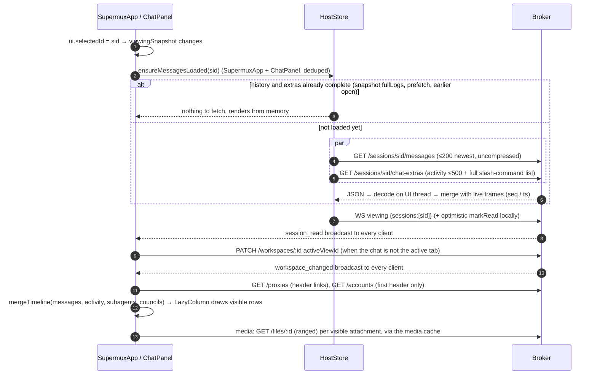
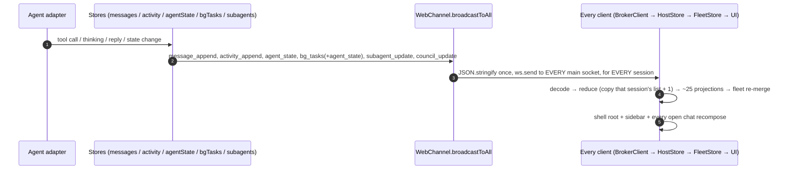

# App load time: how data reaches the screen (card #54, step 1)

Static analysis of the Kotlin apps (`apps/shared`, `apps/ui`, the per-platform entry points) and the
broker's web channel (`src/channels/web/index.ts`, `src/main.ts`), with real sizes taken from the live
broker on 2026-11-03 (~23:35, 150 live sessions, 141 workspaces, 1,435 archived workspaces, 1,505
archived sessions, box load ~25–30). Nothing here changes behaviour; step 2 adds the timing logs.

All measured numbers below were taken **on the box itself over localhost** with a read-only probe device,
so they are the broker's cost plus a loopback hop. A phone over LTE or the relay adds the transfer time
on top.

## Headline numbers (live broker, localhost)

| What | Size | Time |
|---|---|---|
| Startup snapshot, current apps (`logTail:1`, `trimExtras`, `slimArchived`) | **2.37 MB JSON**, 714 KB deflated | subscribe → snapshot **671–988 ms** |
| Same snapshot, an old client (no trim flags) | 16.0 MB JSON, 4.8 MB deflated | 2.5–13 s |
| `GET /archived-sessions` (1,505 rows) | 421 KB (92 KB if gzipped; it is not) | 159–247 ms |
| `GET /sessions/:id/messages` (≤200 newest) | 0.5–180 KB | 11–391 ms |
| `GET /sessions/:id/chat-extras` (activity ≤500 + slash commands) | 42–254 KB | 3–155 ms |
| `GET /agents/models` / `/api/agents` / `/project-catalog` | 29 / 5 / 22 KB | 7–38 ms |
| Live WebSocket traffic, 3 quiet minutes | 124 frames/min, 75 KB/min | 68 % of bytes are `activity_append` |
| `GET /me` (event-loop responsiveness) | — | p50 2.5 ms, p90 8 ms, p99 160 ms |

What the 2.37 MB startup snapshot is made of: `subagents` **860 KB** · `archivedWorkspaces` **749 KB** ·
`logs` 224 KB · `workspaces` 144 KB · `projectMembership` 119 KB · `sessions` 103 KB · `councils` 86 KB ·
everything else < 25 KB each.

---

## (a) App start → connected → workspaces, sessions and Agents on screen

```mermaid
sequenceDiagram
    autonumber
    participant UI as Compose UI (SupermuxApp)
    participant F as FleetStore
    participant H as HostStore + BrokerClient
    participant B as Broker web channel
    participant M as main.ts providers / SQLite

    UI->>F: build FleetStore (per platform)
    F->>F: seed sessions from offline cache (Android/web/iOS only, not desktop)
    F->>H: open(): new HostStore, 10 collectors
    H->>B: WS /ws?clientSurface=… (bearer)
    B->>B: authenticate (devices.json cache), upgrade
    H->>B: {"type":"subscribe", logTail:1, fullLogs:[on-screen ids], trimExtras, slimArchived}
    B->>M: getSessionsSnapshot() + per session: log tail, bgTasks, subagents, councils, agentState
    B->>M: enrichAttachments, listWorkspaces, listArchivedWorkspaces (1,435 × views query), membership, reads, drafts, requests
    B-->>H: snapshot (2.37 MB JSON, one frame), then host_requirements, keep_awake
    H->>H: decode whole frame + reduce (on the UI thread)
    H-->>F: StateFlows emit; F re-merges sessions/messages/agent/lastRead
    F-->>UI: recompose shell + sidebar ("ui.sessions.drawn")
    par after the snapshot, all fired at once
        H->>B: GET /agents/models
        UI->>B: GET /archived-sessions (421 KB)
        UI->>B: GET /agents/:id/avatar, one Agent after another
        H->>B: viewing frame (on-screen chats)
    end
    H->>B: +1 s: prefetch 4 most recent chats, one at a time (messages + chat-extras each)
```

Step by step:

1. **Entry points build the store.** Android `AppViewModel.kt:59-79` (on `viewModelScope`), desktop
   `apps/desktop/.../Main.kt:1100-1117` (on `rememberCoroutineScope()`), web `apps/web/.../Main.kt:359-396`,
   iOS `apps/ios/.../MainViewController.kt:421-445`. Android, web and iOS pass a `HostSnapshotStore` (the
   offline session cache); **desktop passes none**, so the desktop sidebar is empty until the socket's
   snapshot arrives.
2. **FleetStore.init** (`FleetStore.kt:540-554`) seeds each host's sessions from that cache, then `sync()` →
   `open()` (`FleetStore.kt:605-634`) builds one `HostStore` per paired host and launches ten collectors
   that fold its flows into the merged fleet flows.
3. **HostStore.init** (`HostStore.kt:500-509`) starts two coroutines in the caller's scope: the frame
   collector (`client.frames.collect { reduce(it) }`) and `client.run()`. There is **no dispatcher switch**
   anywhere in `HostStore`, `BrokerClient` or `FleetStore`, so on every platform the WebSocket read, the
   JSON decode, the reducer and the fleet merge run on the **UI thread** (Android `Dispatchers.Main`,
   desktop the Swing EDT, iOS/web `Dispatchers.Main`).
4. **Connect.** `BrokerClient.run` (`BrokerClient.kt:58-122`) opens `/ws` with the bearer token and the
   `clientSurface/clientVersion/clientOs` query (`ClientInfo.kt:14-23`). The broker authenticates and
   upgrades (`index.ts:896-915`; `authenticate` uses a stat-cached `devices.json`, `device-store.ts:28-55`).
   Measured `open` on localhost: 6–33 ms.
5. **Subscribe.** The client sends the frame built by `subscribeFrameJson` (`HostStore.kt:2655-2662`):
   `logTail:1`, `fullLogs` = chats on screen, `trimExtras:true`, `slimArchived:true`.
6. **The broker builds the snapshot in one pass** (`index.ts:1576-1648`), sequentially:
   - `getSessionsSnapshot()` (`main.ts:2604-2631`): `gitStatusService.sync`, then one DTO per visible
     session (`registry.listVisible()`, `registry.ts:171`), including a `statSync` per Agent avatar
     (`avatarRev`, `core/agents/avatar/index.ts:145-156`).
   - Per session (150×): `getSessionLog(id, 1)` (one SQLite query each, `messages.ts:119-133`), bgTasks,
     **subagents** (up to 20 finished subagents per session, each with prompt + result up to 8,000
     chars, `subagent-store.ts:52-54`, "small… never trimmed" says `index.ts:1608`), councils,
     agentState; activity/commands only for `fullLogs`.
   - `await enrichAttachments(...)` (`main.ts:2638-2642`): reads media headers for attachments in the
     tails (cached after the first read).
   - `listWorkspaces()` (`main.ts:2924-2934`), `listArchivedWorkspaces()` (`main.ts:2963-2970`) and
     `getProjectMembership()` (`main.ts:2977-2982`): **each** re-lists all workspaces and re-queries the
     internal session ids (`main.ts:2097-2101`), and `toWsDto` (`main.ts:2106-2107`) runs a views query
     (`workspace/store.ts:143`) and a project resolve **per workspace — 1,435 times for archived rows
     whose views `slimArchived` then throws away** (`index.ts:1626-1630`).
   - reads, drafts, requests per session, the permission catalog, then **one `JSON.stringify` of the whole
     object and one `ws.send`** (`index.ts:1642`), followed by `host_requirements` and `keep_awake`.
   - Measured: **671–988 ms** from subscribe to snapshot on localhost, for 2.37 MB.
7. **Client receives one 2.37 MB text frame** (714 KB on the wire with permessage-deflate,
   `CioHttpFactory.kt:11-15`). Before decoding, `BrokerClient.kt:82` scans the whole string for
   `"type":"ping"`; then `json.decodeFromString<ServerFrame>` decodes it in one go (`BrokerClient.kt:89-97`),
   and every frame is also `println`ed (`BrokerClient.kt:105`).
8. **Reduce.** `HostStore.reduce` → `reduceHostFrame` (`HostReducer.kt:12-59`) replaces sessions,
   workspaces, archived workspaces, projects, messages (keeping already-loaded full logs,
   `HostReducer.kt:380-401`), extras, bgTasks, subagents (sorted), councils (sorted), agent state,
   commands, reads, finish jobs. Then `onFrameEffects` (`HostStore.kt:563-576`): send `viewing`,
   **`GET /agents/models`** (`HostStore.kt:2144-2149`, every snapshot), accounts if wanted,
   `prefetchRecentLogs()`, re-send `fs_sub`s, flush the outbox, emit `resynced`.
9. **Fleet merge → UI.** The HostStore's projections (`HostStore.kt:302-342`, ~25 `stateIn`s over one
   `MutableStateFlow<HostState>`) feed FleetStore's collectors; `onHostSessions/Messages/Agent/LastRead`
   (`FleetStore.kt:652-677`) rebuild the merged maps under a lock and publish them.
   `SupermuxApp` (`SupermuxApp.kt:299-324`) collects sessions, workspaces, archived workspaces,
   messages, agent state, subagents, last-read, host views, … The existing trace mark
   `ui.sessions.drawn` (`SupermuxApp.kt:300-308`) fires on the first frames that draw sessions.
10. **Workspaces and Agents.** The sidebar groups workspaces by project; **the Agents zone is not a
    request**, it is the `PA_GROUP_KEY` group of the same workspace list (`SessionListScreen.kt:1549-1568`).
    Each Agent's picture is then fetched by `rememberAgentAvatars` (`AgentAvatarLoader.kt:13-37`):
    `GET /agents/<id>/avatar` **one Agent after another**, for live Agents plus archived ones, cached only
    in composition memory, so every launch fetches them all again.
11. **Right after the first sessions frame**, `LaunchedEffect(sessions) { fleet.refreshArchived() }`
    (`SupermuxApp.kt:357`) fetches **`GET /archived-sessions` (421 KB, 1,505 rows)** to feed the archived
    Agents fold and the archive.
12. **+1 s**, `prefetchRecentLogs` (`HostStore.kt:1788-1801`) loads the 4 most recently active chats,
    **one session at a time** (each: messages + chat-extras in parallel).
13. **Offline cache write** (Android/web/iOS): every change of the merged session list re-encodes all
    sessions and writes them (`AppViewModel.kt:85-96`; Android does it with `runBlocking` DataStore
    `edit` on the main thread, `AndroidSnapshotPersistence.kt:46-51`; web `localStorage`,
    `Main.kt:383-394`).

**What blocks first paint.** On Android/web/iOS the session list can paint from the offline cache before
the socket opens (spec §5); live state (agent working/idle, unread, previews, workspaces on desktop, the
Agents zone) waits for: connect → **subscribe→snapshot build (~0.7–1.0 s on the broker)** → transfer
(714 KB) → decode + reduce on the UI thread → fleet merge → compose. The desktop has no cache, so its
whole sidebar waits for that chain. Agent pictures then arrive one HTTP round trip at a time.

## (b) Opening a chat



1. **Selection.** `ui.selectedId` changes; `viewingSnapshot` is recomputed (`SupermuxApp.kt:427-453`) and
   `LaunchedEffect(viewingSnapshot)` (`SupermuxApp.kt:454-459`) calls `fleet.ensureMessagesLoaded(sid)` and
   `fleet.updateViewing(...)`. `ChatPanel.kt:460` asks again on `session.id`; `logFetches`
   (`HostStore.kt:1722`, `:1743`) makes that one request.
2. **What is fetched.** `loadChat` (`HostStore.kt:1740-1754`) fetches only what is missing: the history
   unless the session is in `completeLogs`, the extras unless in `completeExtras`. Both in parallel.
   - `GET /sessions/:id/messages` (`index.ts:3396-3401` → `main.ts:2632-2642` → `messages.ts:119-133`):
     **the 200 newest messages, all of them, no paging**; `enrichAttachments` fills media sizes, reading
     the file header for old attachments the first time. Measured 0.5–180 KB, 11–391 ms.
   - `GET /sessions/:id/chat-extras` (`index.ts:3376-3385`): the activity ring (≤500 events with tool
     bodies, `activity-store.ts:12-22`) **plus the session's full slash-command list (~42 KB raw, the
     same for every session of an agent kind)**. Measured 42–254 KB.
   - Neither response is compressed: the broker's `json()` writes raw JSON (`index.ts:2004-2006`; only
     the worktree list uses `jsonGzip`) and the CIO clients never ask for gzip (`CioHttpFactory.kt:9-18`).
     A 254 KB extras answer is 69 KB gzipped.
3. **Merge.** `loadFullLog`/`loadExtras` (`HostStore.kt:1756-1778`) merge with anything that arrived live
   meanwhile (`mergeFetchedLog`, `mergeFetchedActivity`, `HostReducer.kt:416-430`).
4. **What is cached client-side.** Everything stays in `HostState` for the life of the process:
   `completeLogs/completeExtras` mean the second open of a chat fetches nothing. A reconnect keeps a
   loaded log when the snapshot tail's newest entry is already in it (`HostReducer.kt:380-384`);
   otherwise the chat is fetched again. Media bytes go through the media cache (`HostStore.kt:248-272`).
   Nothing about chats is persisted across launches.
5. **Side effects of opening.** `viewing` frame → broker `markRead` (`index.ts:1654-1678`) →
   `session_read` broadcast to every client (`read-status.ts:18-27`); a local optimistic `markRead`
   (`HostStore.kt:675-681`) re-merges the whole last-read map. Activating the chat tab may
   `PATCH` the workspace (`SupermuxApp.kt:466-479`), which the broker answers with a `workspace_changed`
   broadcast. `GET /proxies` runs on every open with a header (`ChatPanel.kt:748-753`), `GET /accounts`
   once (`ChatPanel.kt:462`, `HostStore.kt:1932-1943`).
6. **What re-renders.** `rememberChatState` (`ChatPanel.kt:331-368`) collects 15 whole-host maps
   (messages, activity, agent state, bgTasks, commands, requests, subagents, councils, sessions, …) and
   picks this session's entries, so the open chat's state is rebuilt on **every** frame for **any**
   session. `mergeTimeline` is memoised on this session's lists (`ChatPanel.kt:519-521`) and the
   `LazyColumn` only composes visible rows (`ChatPanel.kt:999-1012`).

## (c) New messages and activity arriving live



- **No streaming deltas.** There is no partial-text frame: a reply arrives as one `message_append` when
  it is stored (`index.ts:810-832` for web-channel replies; `main.ts:4058-4066` mirrors every other row).
  What streams is activity: each tool call, result and thinking row is an `activity_append`
  (`main.ts:4067-4069`), ~570 B on average, bodies included.
- **Fan-out is to everyone, for everything.** `broadcastToAll` (`index.ts:834-837`) stringifies once and
  sends to every main `/ws` socket; nothing is filtered by what a client shows. State frames:
  `agent_state` per phase change (`main.ts:4089-4097`), **`bg_tasks` with the session's whole task list
  plus an extra `agent_state`** on every task change (`main.ts:4070-4075`), `subagent_update` with the
  subagent's full view including prompt/result (`main.ts:4076-4083`), `council_update` with the whole
  council (`main.ts:792`), `commands_changed` with the full command list (43 KB seen live,
  `main.ts:1294`).
- **Client side.** Each frame is decoded on the UI thread and printed (`BrokerClient.kt:78-106`), then
  reduced: `MessageAppend` copies the session's list and appends (`HostReducer.kt:180-195`),
  `ActivityAppend` does the same **with no cap** (`HostReducer.kt:216-218`) — the broker keeps 500 per
  session, the client keeps everything it has seen since launch, for every session, open or not.
- **Nothing re-fetches on a message**, but every message for any session makes FleetStore rebuild the
  merged messages map (`FleetStore.kt:664-667`, `:743-749`) and `SupermuxApp` (which reads
  `fleet.messages`, `fleet.agentState`, `fleet.lastRead`, `fleet.subagents` at its top level,
  `SupermuxApp.kt:312-324`) recompose from the root; `lastBySession` is recomputed for all sessions
  (`SupermuxApp.kt:324`). Inline lambdas created in that body (e.g. `appFor`, `SupermuxApp.kt:340`) are
  new on every pass, which stops children that take them from skipping.

## (d) Workspace and session list updates

Mostly diffs, with three full-list exceptions:

| Frame | Shape | Source |
|---|---|---|
| `session_added` | full `SessionInfo` (upsert) | create/resume paths |
| `session_removed`, `session_renamed`, `sessions_reordered` | id-level diff | `main.ts:1587, 2190, 2922` |
| `session_state` | patch (mute, connected, model, effort, fast, permission, account) | `main.ts:1477`, `index.ts:3406` |
| `session_git`, `finish_job`, `agent_avatar_changed` | per-session diff | `main.ts:900, 1570, 1957` |
| `session_read` | per-session read pointer | `read-status.ts:26` |
| `workspace_added/changed` | full `WorkspaceDto` (with views + layout) | `index.ts:3940-4078` |
| `workspace_removed`, `workspaces_reordered`, `view_*` | diffs | same |
| **`projects_changed`** | **whole catalog + membership of all 1,576 workspaces (~140 KB)** | `index.ts:860-866`, only on catalog changes |
| **`agents_changed`** | "reload" signal → the Agents dialog refetches `GET /api/agents` | `main.ts:1953-1958` |
| **any change to the session list** | **the client re-downloads `GET /archived-sessions` (421 KB)** | `SupermuxApp.kt:357` |

Unread is computed client-side from `lastRead` vs each session's newest message ts (snapshot `reads`
+ `session_read`); avatars refetch only when the hash in `SessionInfo.avatar` changes.

---

## Suspected waste, ranked by likely impact

Ranked by what it costs on a cold start and a chat open for ~150 sessions. Items marked **(measured)**
have a live number above; the rest step 2 will quantify.

1. **The startup snapshot is ~70 % payload the first screen does not use (measured).** Of 2.37 MB:
   `subagents` 860 KB — finished subagents' full prompts and results, when the sidebar only needs the
   running count (`runningSubagentCount`, `SubagentCard.kt:334`); `archivedWorkspaces` 749 KB — 1,435 rows
   for a folded section; `projectMembership` 119 KB, mostly archived workspaces. It is built in
   0.7–1.0 s, sent as one frame, and decoded in one piece on the UI thread.
2. **`GET /archived-sessions` (421 KB, 1,505 rows) is re-fetched on every change to the live session
   list (measured size; frequency to confirm).** `LaunchedEffect(sessions) { fleet.refreshArchived() }`
   (`SupermuxApp.kt:357`) fires on `session_added/removed/state/renamed/reordered`, `session_git`,
   `finish_job`, avatar changes… In the 3 quiet minutes probed there were at least 4 such frames, which
   would be ≈1.7 MB of HTTP against 226 KB of all WebSocket traffic. Requests are not cancelled when a
   newer one starts (`HostStore.kt:865-869`), and `session_removed` fires one more
   (`HostStore.kt:579-582`). Each answer is decoded on the UI thread.
3. **HTTP JSON is never compressed (measured).** The broker's `json()` writes raw JSON
   (`index.ts:2004-2006`), and the CIO clients send no `Accept-Encoding` (`CioHttpFactory.kt:9-18`).
   Chat opens and the archive list cross the network at 3.5–4.5× their gzipped size, which matters on a
   phone and through the relay, not on the LAN.
4. **The snapshot builder does N+1 work on archived workspaces.** One views query and one project
   resolve per archived workspace (1,435), views then discarded by `slimArchived`; the full workspace
   list and the internal-session query run three times per snapshot (`main.ts:2097-2107, 2924-2982`).
   `/archived-workspaces` alone takes 160–280 ms for the same rows, so this is likely a large share of the
   0.7–1.0 s.
5. **All client-side decode, reduce and merge run on the UI thread.** The stores inherit the caller's
   scope (`HostStore.kt:187-188, 505-506`; `FleetStore.kt:162`) and none switch dispatchers; that
   covers the 2.37 MB snapshot decode, every frame, and every HTTP JSON body (`BrokerApi.kt:1776-1791`).
   Every frame is also `println`ed (`BrokerClient.kt:105`), and the ping check scans every frame's
   full text (`BrokerClient.kt:82`).
6. **Whole-app recomposition on live traffic.** The shell root collects the merged messages, agent
   state, last-read and subagent maps (`SupermuxApp.kt:299-324`), and every open chat collects 15
   whole-host maps (`ChatPanel.kt:331-368`), so each `activity_append` / `agent_state` for *any* of 150
   sessions recomposes the root, the sidebar and open chats. The 2026-09-26 work noted a 181 ms
   whole-shell recompose after a 2 ms state change; step 2 counts recompositions.
7. **Chat open downloads the full slash-command list every time (measured).** ~42 KB raw per session in
   `chat-extras`, identical across sessions of the same agent kind; `commands_changed` repeats it live
   (43 KB). Plus up to 500 activity rows with tool bodies (up to 254 KB raw).
8. **Agent avatars load one at a time and are re-fetched every launch.** `AgentAvatarLoader.kt:22-35`
   awaits each `GET /agents/<id>/avatar` in turn, for live and archived Agents, cached only in
   composition memory. Through the relay (~0.5 s per round trip, 2026-09-26 measurement) ten Agents
   take seconds to all show.
9. **Desktop has no offline session cache.** `Main.kt:1103-1116` passes no `HostSnapshotStore`, so the
   desktop sidebar is blank until connect + snapshot + decode completes.
10. **Client activity lists grow without bound, with a full copy per event.** `HostReducer.kt:216-218`
    (the broker caps at 500, `activity-store.ts:12-22`), for every session because every frame is
    broadcast to every client. Memory and per-event cost grow with app uptime.
11. **The offline cache is rewritten on the UI thread for every session-list change** on Android
    (`runBlocking` DataStore edit, `AndroidSnapshotPersistence.kt:46-51`, from `AppViewModel.kt:85-96`),
    web (`localStorage`) and iOS: all 150 sessions encoded each time.
12. **Smaller items.** `GET /agents/models` on every snapshot (29 KB); `GET /proxies` on every chat open;
    `bg_tasks` frames carry the whole task list plus a duplicate `agent_state`; the 4-chat prefetch runs
    one session at a time from +1 s; an old-protocol client still gets a 16 MB snapshot (5.8 MB of it
    slash commands).

Not waste, for the record: the snapshot already trims logs to one entry and drops activity/commands
for chats not on screen (the 2026-09-26 work); chat history and extras load in parallel; a chat
already loaded is never fetched again; avatars only refetch when their hash changes.
