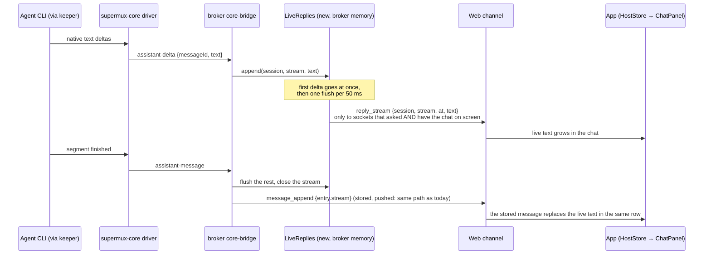

# Streaming replies — research and proposal (card #76)

Status: **approved 2026-11-05 with Ahmet's answers (§8), being built.** Branch `mux/streaming-replies` (from `dev`
`2b27abebf`). Measured on this box 2026-11-05 with throwaway sessions; the live broker was not touched.

## The short version

**Mental model: a reply is *live* until it is stored.** The broker keeps the live text of the reply being
written and shows it to whoever has that chat open. When the agent finishes the text, the broker stores the
message exactly as it does today, and that stored message takes the live text's place on screen. Nothing about
storage, history, push, unread or older apps changes. Only the open chat gets something new.

- **Every agent CLI already streams, and supermux-core already turns all of it into `assistant-delta` events.**
  Claude has run with `--include-partial-messages` since headless Claude sessions arrived on 2026-09-22
  (`5fd5d237f`). The deltas are thrown away in one place in the broker
  (`src/core/agents/core-bridge/normalized-bridge.ts:136`).
- Measured, a 700–1,200-character reply shows its **first words 1.8–3.4 s before the stored message appears
  today**, and the gap grows with length. Text arrives at 240–830 characters a second.
- Proposed: the broker relays deltas, merged into **one frame per 50 ms**, only to apps that ask for them and
  only for chats on screen. Each frame says where its text starts, so a reconnect or a chat opened mid-reply
  catches up in one frame.
- Older apps never ask, so they get exactly what they get today. A new app on an older broker sees no deltas
  and works as today.
- The UI is shared Kotlin, so one implementation covers desktop, Android, iOS and web. Roll it out
  **desktop first** by turning the request on per platform.

## 1. What each CLI exposes, verified on this box

Every probe ran one turn through supermux-core itself, with the core's own drivers, cheap models, an empty
scratch directory, and each CLI's own login. The script is `~/streaming-probe/probe.ts`; raw event logs are in
`~/streaming-probe/out/`. "First words earlier" means the first delta compared with the final
`assistant-message`, which is when the app sees the reply today.

| Agent (CLI version) | Native stream | Verified | Deltas | Text per delta (p50 / p90) | Gap between deltas (p50 / p90) | First words earlier | Cost of the probe |
|---|---|---|---|---|---|---|---|
| Claude 2.1.308, Haiku 5.5 low | `stream_event` → `content_block_delta` `text_delta` (+ `thinking_delta`) | ✅ | 92 for 1,171 chars, 52/s | 11 / 23 chars | 20 / 27 ms | **1.8 s** | $0.0030 (+$0.0024 tool turn) |
| Codex 0.164.0, gpt-5.6-luna low | app-server `item/agentMessage/delta` | ✅ | 169 for 680 chars, 60/s | 3 / 8 | 0.3 / 63 ms (bursts) | **3.0 s** | 20.5k in / 308 out tokens, ChatGPT plan |
| Grok 1.0.46, grok-4.7-build-fast low | ACP `agent_message_chunk` (+ `agent_thought_chunk`) | ✅ | 190 for 760 chars, 72/s | 3 / 8 | 6 / 35 ms | **3.4 s** | subscription; Grok reports no tokens |
| Antigravity `agy` 1.5.1, gemini-3.8-flash-low | stream-json `step_update` `text_delta` | ✅ | 49 for 1,094 chars, 20/s | 24 / 48 | 27 / 156 ms | **2.4 s** | 7.1k in / 287 out tokens |
| Cursor 2026.09.18, ACP | `agent_message_chunk` | ⚠️ not provable | — | — | — | — | 0 tokens: the account is at its free-plan limit ("Upgrade your plan to continue" arrived as one chunk) |
| OpenCode 1.18.34, ACP, Zen `deepseek-v4.1-flash-free` | `agent_message_chunk` (+ `agent_thought_chunk`) | ✅ after Ahmet's new key | 71 for 969 chars, bursts | 13 / 24 | 0.5 / 6 ms (bursts) | **2.0 s** | $0 (free model). Before the new key every OpenCode prompt failed with "This API key has expired". A retry on `opencode-go` timed out in setup at load ~226, so that provider is not re-verified |

What held for every agent that answered:

- **Deltas are pure appends.** The concatenation of the deltas equals the final text, character for character,
  for all four. None is cumulative. The old pre-ACP Cursor stream was cumulative. Under ACP the stored reply is
  the concatenation of the chunks, so cumulative chunks would store repeated text, and the 7 Cursor replies
  stored since the ACP switch show none. That small sample is consistent with deltas, not proof.
- **Each text segment has its own id, and its final arrives before the next thing happens.** Claude, with text,
  a `Read` tool call, then text: segment 1 (`msg_A:0`) finished at 4.78 s, the tool started at 4.81 s, and
  segment 2 (`msg_B:0`) streamed from 6.88 s with its final at 7.25 s. The ACP normalizer closes a segment at the
  next `tool_call`, Codex at the item's `item/completed`, and agy when the step is `DONE`.
- Time from the last delta to the final is 0–160 ms for Claude, Codex and agy. For Grok it is 0.8 s, because
  the ACP driver only closes the text at turn end.

**Where the deltas are dropped today:** not in the core. All four drivers emit `assistant-delta` with a stable
`messageId` that matches the final (`claude/normalize.ts:466-479`, `codex/normalize.ts:650-655`,
`acp/normalize.ts:393-405`, `antigravity/normalize.ts:115-120`), and the broker passes `partialMessages: true`
(`src/core/agents/claude/core-host.ts:192`). The broker's bridge accumulates them into `pendingAssistant`, which
is only used as a fallback when a turn ends without a final (`normalized-bridge.ts:136-139`). `reasoning-delta`
is dropped at `normalized-activity.ts:428`. Subagents' text is never the parent's reply: Claude subagent stream
frames are dropped in the core (`claude/normalize.ts:692`), and the bridge drops every body that carries a
`subagentId`. So no CLI or core change is needed for v1. The keeper already journals these frames today, so
there is no new journal cost.

## 2. The pipeline, today and proposed

Today: an agent's text reaches the app only as `message_append`, after the whole segment is written
(`docs/perf/2026-11-03-load-time-data-flow.md` §c: "No streaming deltas").



Stage by stage:

1. **Core:** unchanged.
2. **Bridge** (`normalized-bridge.ts`): for main-thread, non-replay `assistant-delta`, emit a new adapter event
   `assistant-delta {stream, text}`. The broker mints `stream` (random, short), one per core `messageId` per
   turn. The core's ids are not unique across turns (ACP reuses `assistant:1`). The final `assistant-message`
   event carries the same `stream`. When the bridge drops a final (empty, or the same text as the previous
   message) or a turn ends with a stream still open, it emits `assistant-stream-end`.
3. **`main.ts`**: `wireAdapterEvents` forwards the two new events to `LiveReplies`. `onAssistantMessage` puts
   `stream` on the stored entry (`entry.stream`). Push, routing and storage are untouched.
4. **`LiveReplies`** (new, about 150 lines, next to the web channel): per session, the open stream's whole text
   so far; per socket, how far it has been sent (a cursor). It runs one 50 ms tick and sends each watching
   socket `text.slice(cursor)`. It flushes immediately before the final is stored, so no delta can arrive after
   its message.
5. **Web channel**: `subscribe.streams: 1` is the opt-in, and each socket's own `viewing` frames say which
   chats it has on screen. The existing `viewingTracker` is per device, for push; this is per socket.
   `snapshot.streams` carries any open stream for the chats in `fullLogs`.
6. **App** (shared Kotlin): new frames go into a **separate small flow**, `liveReplies: Map<session, LiveReply>`,
   not the big `HostState`. A delta then recomposes only the streaming row, not the shell, the sidebar or the
   fleet merge (data-flow doc, waste #5 and #6).

## 3. Design decisions

**3.1 Live text vs the final: replace, never append.** The stored message is the truth. It arrives as today's
`message_append` with `entry.stream = <id>`, and the reducer removes the live reply with that id and appends the
entry in the same step. Messages are keyed as `entry.stream ?: entry.id` and the live row is keyed by its
stream, so the `LazyColumn` keeps the same slot and nothing jumps. On web the stored text is the streamed text,
trimmed (`transformOutbound` only prefixes text on multiplexed Telegram chats), so the swap shows no change.

**3.2 Tool calls in between.** One stream per text segment, as measured in §1: text, then tool row, then text.
The live row is always the last row while it exists. Rows that land meanwhile, such as a background subagent's
activity, sort above it by their timestamp, and the stored message's own timestamp is later than theirs, so it
takes the same position. The "working" row is hidden while text is streaming, because the text is the progress,
and comes back between segments.

**3.3 Who gets deltas.** Only sockets that sent `subscribe.streams: 1` **and** have that chat on screen and
visible. A phone in the background, a chat not open, and old apps get nothing. When a chat comes on screen
mid-reply, the broker resets that socket's cursor to 0, and one frame (`at: 0`) carries the text so far. A slow
socket (`getBufferedAmount()` high) skips ticks, and its next frame simply carries more, because the cursor is
per socket.

**3.4 Reconnect, broker restart, history.** **Deltas are never stored**: not in SQLite, not in the activity
ring. History holds only the final message, exactly as today, so the history endpoints and old apps are
unaffected.
- App reconnect mid-reply: `snapshot.streams` restores the live text, and the next frames continue from it.
- Broker restart mid-reply: the keeper re-attach replays what the agent wrote meanwhile, the core re-emits
  those deltas inside the turn (`core.ts:889-899`), the new broker rebuilds the live text, and apps reconnect
  to it.
- Interrupt (Stop): the bridge's existing `flush()` already stores whatever text was written, so the reader
  keeps what they saw.

**3.5 Markdown while incomplete.** The chat parser is IntelliJ's GFM/CommonMark parser (`apps/shared/.../ui/Markdown.kt:58`).
- **An unclosed code fence already renders as an open code block to the end of the text** (the CommonMark
  rule), which is exactly what a half-written code block should look like. No work needed.
- Tables: a header row shows as text until its `|---|` line arrives, then becomes a table. Rule: while live,
  hold back the last unfinished line if it starts with `|`.
- Inline: a dangling `**`, `` ` `` or `_` at the very end is hidden until it closes, so it doesn't flash.
- Cost: `MarkdownBody` re-parses the whole text on every recomposition (`ui/chat/Markdown.kt:393`). At most 20
  parses a second for one row is fine for normal replies. Measure on the slowest targets (wasm, iOS) with
  `PerfTrace` in step 2, and only if long replies stutter, cache the parse of the settled blocks and re-parse
  only the last one.

**3.6 Scroll.** #1's rules already describe the wanted behaviour: follow only while the end is on screen
(within 48 dp), and pin when the last row that was already on screen grows (`ChatPanel.kt:158`, `:688`). The live
row is that last row: at the bottom the chat follows the text, and a reader who scrolled up stays put. To keep
this, the live row must be part of the list the autoscroll measures (append it after `mergeTimeline`, outside
its `remember`, and read its text inside the row). `ChatAutoscrollTest` gets three cases: live text growing at
the end is followed, a reader scrolled up stays put, and the swap to the stored message does not move.

**3.7 Notifications, unread, previews, channels.** Nothing changes, by construction: deltas never pass through
`onAssistantMessage`, so they never store, push (`firePushForReply`), mark unread, notify locally
(`HostStore.agentReplies` fires on `message_append`), update the sidebar preview or reorder the session list.
Push fires on the stored message only. Telegram, WhatsApp, the Watch and the notification extensions get the
stored message as today; no work there. The sidebar keeps its existing "working" state and shows no live text.

**3.8 Ends without a final.** `reply_stream_end` covers a dropped final (empty, or a duplicate of the previous
message), an error, and a turn that ends with a stream open. It is tiny and rare, so it goes to every socket
that opted in. Safety net: the app drops a session's live reply when the chat leaves its screen (the broker
resyncs it with `at: 0` on return), on every snapshot, and when the session goes idle.

## 4. Bandwidth and battery

- **Frames:** coalescing at 50 ms caps a streaming chat at 20 frames a second, against the measured 20–72
  native deltas a second. The first delta is sent at once, so first-word latency is not traded away. At the
  measured rates a frame carries 12–33 characters plus about 100 bytes of envelope, so about **2–3 KB/s raw
  per chat on screen while it streams**. Permessage-deflate (already on) shrinks the repeated envelope to
  roughly a quarter. For scale: the live socket moves about 1.25 KB/s on a quiet minute today.
- **Large replies:** each frame carries only new text, so total bytes are the reply plus the envelopes. A 20 s
  reply is about 400 frames: roughly 44 KB of envelopes plus 10 KB of text raw, and around 15 KB deflated. Then
  the stored message carries the text once more, which keeps old apps and storage unchanged. A chat opened
  mid-reply costs one catch-up frame.
- **Battery:** the cost is wake-ups and recomposition more than bytes, so:
  - deltas flow only while the chat is on screen and the app is in the foreground; screen off or backgrounded
    means `viewing` goes false and zero frames are sent;
  - the reducer is a string append in a separate flow, so only one row recomposes;
  - no `println` for these frames (`BrokerClient.kt:121` prints every frame today);
  - the parse is throttled to the frame clock.

  If the phone trace shows a cost, phones can ask for 100 ms. The protocol allows it; v1 doesn't need it.
- **Broker:** one `JSON.stringify` per stream per tick, and nothing written to disk.

## 5. Protocol change (versioned)

```jsonc
// app → broker: opt in on the existing subscribe (integer, so a v2 can be negotiated later)
{"type":"subscribe", "...": "...", "streams": 1}

// broker → app, only to sockets that opted in and have the chat on screen
{"type":"reply_stream", "session":"<sid>", "stream":"k3v9q2", "at":1180, "text":" and the rest"}
{"type":"reply_stream_end", "session":"<sid>", "stream":"k3v9q2"}

// the stored message, as today, plus one field; older apps ignore it (ignoreUnknownKeys = true)
{"type":"message_append", "session":"<sid>", "entry":{"id":"out:web:…", "text":"…", "stream":"k3v9q2", "...":"..."}}

// on (re)subscribe, open streams for the chats in fullLogs
{"type":"snapshot", "...":"...", "streams":{"<sid>":{"stream":"k3v9q2","text":"…so far"}}}
```

App rule for `reply_stream`, applied for the same `stream`: `at == 0` replaces the text, `at == length`
appends, `at < length` appends only the part not already held, and `at > length` (a gap) keeps what it has and
waits for the next `at: 0` or the stored message. A new `stream` id replaces the previous live reply. `at` counts
UTF-16 units, which is what both JS and Kotlin string lengths count. The broker never ends a batch between the
two halves of a surrogate pair.

Compatibility:
- **Old app + new broker:** it never sends `streams`, so it receives none of these frames. It would skip them
  anyway (`BrokerClient.kt:106-112`), but not sending them saves the decode-and-log per frame.
- **New app + old broker:** `streams` is ignored, no frames come, and the stored message arrives as today.

## 6. Three ways to do it

1. **Recommended: the live reply beside the log** (this document). Deltas are transient, coalesced, sent only
   to opted-in sockets that have the chat open, and replaced by the stored message. Storage, push and old apps
   are untouched.
2. **Store the message at the first word and edit it as it grows** (`message_update` frames). One concept,
   and reconnect comes for free from the log. But it writes SQLite on every update; push, unread and the
   preview would see a message before it is finished (each would need an exception); and **old apps would show
   a frozen first fragment**, which breaks "older apps keep working on the final message". Rejected.
3. **Forward every raw delta to every socket.** The smallest broker change. But it means 20–72 frames a second
   per streaming session, sent to every app for every session (the data-flow doc's fan-out problem, times
   fifty), and old apps would fail to decode and print each one. Rejected; it is only the baseline.

## 7. Plan and order

1. **Broker, dark**: no app asks yet, so there is zero behaviour change and it is safe to deploy first.
   - The bridge emits `assistant-delta`, `stream` and `assistant-stream-end`.
   - `LiveReplies` (tick, per-socket cursors, flush before the final, backpressure skip).
   - The `subscribe.streams` opt-in, per-socket viewing, `snapshot.streams` and `entry.stream`.
   - Bun tests: the bridge on the real delta sequences recorded in §1; the coalescer on a fake clock; routing
     (opted in or not, on screen or not, congested); reconnect; interrupt; dedupe.
2. **Shared app**: one implementation, so the work is done once, but the request goes on per platform.
   - `Frames.kt`: `ReplyStream`, `ReplyStreamEnd`, `Snapshot.streams`, `LogEntry.stream`.
   - `HostStore`: the `liveReplies` flow and its reducer rules, the per-platform `streams` request, and no
     printing of these frames. `FleetStore` merges it per host.
   - `ChatPanel` and `Timeline`: the live row (an `AssistantMessage` without time or copy row and with a quiet
     caret), keys, hiding the working row, and the Markdown tail rules.
   - Tests: reducer unit tests and the three `ChatAutoscrollTest` cases.
3. **Rollout, desktop first:**
   1. Turn on desktop and verify with real agents: Claude, Codex, Grok and Antigravity, plus Cursor and
      OpenCode once their accounts work.
   2. Android on a real phone, with `PerfTrace` for jank and battery.
   3. iOS on the Mac (lease).
   4. Web (wasm).

   Each step is one flag flip, and nothing per platform is expected beyond verification. Telegram gets no work.

Rough size: broker about 400 lines with tests; app about 350 lines with tests, plus a verification pass per
platform.

## 8. Decisions (Ahmet, 2026-11-05)

1. **Preview: the last stored message only, never live text.** He notes it matters for Agents, because the
   Agents zone shows a preview line. That line keeps reading stored messages only.
2. **Stream the thinking too, where the agent exposes it**: shown as thinking, distinct from the reply, with a
   clean fallback where an agent doesn't expose it. Designed in §9.
3. **50 ms batches everywhere.**
4. **Subagent text stays out of v1.**

He also added a new OpenCode key. OpenCode is now verified live (§9).

## 9. Thinking (added after decision 2)

**What each agent exposes, verified on this box:**

| Agent | Thinking stream | Out of the box | What it takes |
|---|---|---|---|
| Claude | `thinking_delta` | **No text.** The live Claude journals hold 101,370 thinking deltas, every one empty (`thinking_display: "updates"`) | The hidden CLI flag **`--thinking-display summarized`**. Haiku 5.5 then streamed 46 deltas, 557 chars of summarized thinking ($0.0025). Values the CLI accepts: `summarized`, `omitted`, `highlights` |
| Codex | `item/reasoning/summaryTextDelta` | **No.** Zero reasoning deltas in the live journals | Config **`model_reasoning_summary = "auto"`**. gpt-5.6-luna (medium) then streamed short headings ("**Drafting six-line Python squares code**"), one per summary part |
| Grok | ACP `agent_thought_chunk` | Yes, text (6 deltas in the probe) | nothing |
| OpenCode | ACP `agent_thought_chunk` | Yes, text: 62 deltas (Zen `deepseek-v4.1-flash-free`, $0; the reply streamed 71 deltas, first words 2.0 s early) | nothing |
| Cursor | ACP `agent_thought_chunk` | Seen in history replays; live not provable (plan limit) | nothing |
| Antigravity | none in stream-json | No | fallback: the "working" row, as today |

**Design.** Thinking is a second kind of live stream on the same machinery:
- Frames: `reply_stream {…, kind: "thinking"}`; a reply stays the default kind.
- One thinking stream per reasoning block. The broker opens it only on the first non-empty text, so a redacted
  agent never opens one.
- The stored thinking is today's `reasoning` activity row (`activity_append`), now carrying the same `stream`
  id. It replaces the live thinking in place, just as a stored message replaces a live reply.
- Claude streams thinking and then text inside ONE message, and stores both at the end of it. So a session can
  have a thinking stream and a reply stream open at once, at most one of each.
- In the app, live thinking is the existing "Thinking…" card, expanded, with the text arriving in the muted
  thinking style. Only the last few lines show, so a long think doesn't push the chat around. It folds back to
  the usual collapsed card when its text is stored, or as soon as the reply starts.
- Agents with no thinking text keep today's behaviour: the "Thinking…" spinner for redacted thinking and the
  working row.

**Three things the probes turned up, fixed as part of this:**
1. **Claude's `system/thinking_tokens` progress frames** come one per thinking delta. Core turns each into an
   empty `reasoning` body, and the broker turns each into its own "Thinking" activity row, broadcast to every
   app and kept in the 500-row ring. That is 3 rows a turn today and about 45 with summarized thinking. The
   broker will keep one redacted row per stretch of thinking instead of one per update.
2. **Codex summary parts run together** when streamed, because core drops `summaryPartAdded`. Core will emit
   a paragraph break between parts, matching how the stored text joins them.
3. Turning on Claude's summarized thinking and Codex's summaries is an **agent configuration change**:
   - It applies when a session's CLI next starts. Keeper-held sessions keep running unchanged until then.
   - Claude counts a changed thinking display as a prompt-cache break, so **each Claude session pays one cold
     turn the first time it restarts with the flag**. That is often moot: a session idle for more than an hour
     is cold anyway.
   - Both get their own switch in the broker, so they can be turned off without touching streaming.

Adjacent, not part of this card: today every text segment of a turn is its own stored message, and **each
fires a push** unless you are present (`src/core/push/hook.ts` has no per-turn collapse), so "I'll read the
file." pushes as well as the answer. Streaming doesn't change that. If "push only on the final message" was
meant as "the turn's last message", that is a separate small change.
