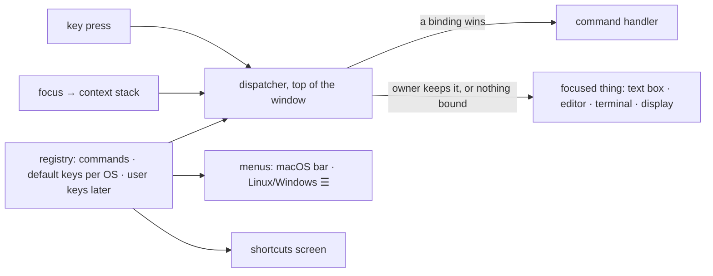

# Central keyboard shortcuts: Design (2026-11-07, card #96)

**Status:** approved by Ahmet on 2026-11-07, with all four recommendations (see **Questions**, at the end).
Building on branch `mux/central-shortcut-system`, in the build order below.

## Goal

Ahmet, 2026-11-07: *"shortcuts should be handled globally: whenever the app is open (even when focus is
just on the app chrome), the shortcut is caught and handled. One central shortcut handler that also knows
WHERE it was triggered, so the same key can behave differently in a given input than globally."*

- Every app shortcut works whenever a supermux window is in front, wherever the focus is: a text box, the
  editor, the terminal, the sidebar, or nothing at all.
- One list of commands, with default keys per OS, a shortcuts screen generated from it, rebinding later.
- The terminal, the editor and the remote display keep the keys they own (^T in the shell).
- One rule for ⌘ versus Ctrl (moved here from #29, Q9).

## The model

> Every shortcut is a **command** (an id, a title, a handler) with **keys per OS** and a **context**: where
> it applies. **One dispatcher per window** sees every key before anything else. It reads where focus is as a
> stack of contexts (for example `terminal › pane › workspace › window`) and picks the binding in the deepest
> context that has one. **The focused thing keeps every key it uses; the app takes the rest.**

## What exists today (audit)

Every handler in `apps/ui`, `apps/desktop`, Android, iOS, web, the editor, its plugins and the terminal was
read (two read-only sweeps; the load-bearing lines re-checked by hand).

| Keys today | Does | Handled where | Works when |
|---|---|---|---|
| Ctrl **or** ⌘ + N / ⇧N / B | new session / move workspace to a new window / sidebar | `ShellShortcuts.kt:74`, bubble phase, on an inner box (`SupermuxApp.kt:791-799`) | only while something inside that box has focus |
| Ctrl **or** ⌘ + T | new terminal | `ShellShortcuts.kt:96`, preview phase, same box | same; it also takes ^T from the shell, on every OS |
| Ctrl **or** ⌘ + F | find in chat | `ChatPanel.kt:982` | only with focus inside the chat |
| Ctrl **or** ⌘ + P | go to file | `FileSearch.kt:153`, bubble phase | only with focus inside the Files pane |
| Ctrl **or** ⌘ + V | paste an image | `Composer.kt:1574` + a menu accelerator switched by a global flag (`Main.kt:1024`) | composer focused |
| ⌃N (sic) | New Session in the macOS menu bar | `Main.kt:987`, `MenuShortcut(Key.N, ctrl = true)` | the menu shows ⌃N, so ⌘N has no menu item behind it |
| F10, Alt+F/E/V | main menu under the Linux/Windows custom title bar | `Main.kt:910`, the window's own key handler | always, even in the terminal, where the shell loses Alt+F (forward word) |
| ⌘C/V/A/F/=/−/0 **and** Ctrl+Shift+C/V/A/F/=, both on every OS | terminal copy, paste, select all, find, zoom | `TerminalShortcuts.kt:22-82` | terminal focused |
| ~60 bindings (`"Mod-s"`, `"Shift-Mod-k"`…) | the editor's keymap, ⌘ on Apple and Ctrl elsewhere | `editor-core/…/Commands.kt:40-80` + plugins | editor focused |
| Ctrl **or** ⌘ + Enter, any OS | send a review comment | `ReviewWidgets.kt:122` | review field focused |
| Esc, Enter, arrows | close / pick / move in ~25 panels, popups and lists | each panel | that panel focused |

**Why ⌘N only works while an input has focus.** Inside a window, Compose gives a key only to the focused
node and its parents. The shortcuts hang on a box inside the content, and many ordinary actions leave
*nothing* focused: a click in the transcript (`ChatPanel.kt:1310`, `clearFocus()`), any sidebar row (they
cannot take focus, `WorkspaceRow.kt:527`), Esc in go-to-file, five places in the editor panel, every tab switch
on the phone (`WorkspacePanes.kt:544`). From then on no shortcut fires until something is focused again. Only
the desktop window's own handler sees every key whatever is focused (`Main.kt:910`, confirmed in the Compose
1.12 library), and today it only opens the Linux menu.

**Other faults:**
1. **Three ⌘/Ctrl rules at once:** the editor is strict (⌘ on Apple, Ctrl elsewhere); the desktop menu is
   Ctrl-only; all 11 checks in `apps/ui` take *either*, and so does the review field (`ReviewWidgets.kt:122`).
   So on a Mac ⌃F, ⌃P and ⌃V are app shortcuts, and on Windows/Linux Super+F/P/V are.
2. **The terminal hands nothing up.** Every key it can name goes to the program
   (`TerminalKeyMap.kt:249-272`): on a Mac ⌘T, ⌘N, ⌘W, ⌘B, ⌘, are sent as Super+key and vanish. The only way
   past it is the Ctrl/⌘+T hack, which steals ^T (fzf's file picker) on every OS. It also leaves the key's
   release to reach the terminal.
3. **Extra windows have no shortcuts at all** (desktop `DetachedWorkspaceWindow.kt`, Android
   `ExtraWindowActivity.kt`).
4. **No list anywhere.** Menus copy their labels by hand; `WorkspaceShortcuts.kt` is dead code.
5. **Web:** the editor catches its own chords on the page, before Compose (`Platform.wasmJs.kt`). In a browser
   tab, ⌘/Ctrl+N, T and W belong to the browser.
6. **Tablets:** the iPad registers no key commands, so the iPadOS 26 menu bar (which replaced the hold-⌘
   overlay) lists nothing of ours; Android lists nothing in its keyboard-shortcuts helper (Meta+/).

## How others do it

| App | Commands and keys | Context | Terminal |
|---|---|---|---|
| **VS Code** | a command registry; `keybindings.json` = `{key, command, when}`, `-command` removes a default; per-OS `mac`/`linux`/`win`; `CtrlCmd` = ⌘ on macOS, Ctrl elsewhere | `when` clauses over context keys (`editorTextFocus`, `inputFocus`, `terminalFocus`…); evaluated bottom-up, user rules last, so the user wins | every **⌘** key goes to the workbench; a Ctrl key goes to the shell unless its command is on `commandsToSkipShell` (a long default list: VS Code takes Ctrl+P from bash on Linux) |
| **JetBrains** | actions with ids; a separate macOS keymap (Ctrl↔⌘ swapped) | keys local to the focused component first, then the keymap; the first *enabled* action wins (`update()` reads the focused component) | the shell gets every key except an allowlist (go to file, settings, tabs, splits…), and an allowlisted key goes to the shell anyway when its action is disabled |
| **Zed** | actions; keymap JSON with a `context` per block; `secondary-` = ⌘ on macOS, Ctrl elsewhere; one default keymap per OS | the context tree from the focused element up to the workspace: **the deeper context wins**, the later binding on a tie | unbound keys go to the PTY; the keys the shell needs are re-bound in `Terminal` to "send keystroke"; on Linux its own terminal actions are **Ctrl+Shift** |
| **Linear / Raycast** | single-letter keys, ⌘K, `?` for a searchable shortcuts screen; Raycast declares each shortcut per OS (`{macOS: cmd, Windows: ctrl}`) | single-letter keys are off while typing | n/a |

What they share, and what we take: **one registry** (all); **a primary-modifier alias, never "either"** (all);
**contexts read from focus, deepest wins** (Zed: it maps one to one onto Compose's focus tree); **an explicit
rule for what the terminal keeps** (all three editors, each a different list).

Sources: VS Code `keybindingResolver.ts`, `terminalInstance.ts`, the when-clause reference; IntelliJ
`IdeKeyEventDispatcher.kt`, `MacOSDefaultKeymap.kt`, `TerminalEventDispatcher.kt`; Zed's key-bindings docs,
`default-linux.json`, gpui `window.rs`; Linear's and Raycast's docs.

## Design

### 1. The pieces

- **Commands.** `Command(id, title, group)`, for example `session.new`, `workspace.newTerminal`,
  `sidebar.toggle`. The handler is registered by whoever owns the state, while it is on screen:
  `RegisterCommand("workspace.newTerminal") { … }`. This is today's `ui.newTerminalAction`, generalised. A
  handler may **decline** (paste-image with no image in the clipboard); the key then goes on as if unbound.
- **Keymap.** One file of defaults: `bind("Mod-t", "workspace.newTerminal", context = Workspace)`, with an
  optional per-OS key. The chord grammar is the editor's existing `KeyChord` (`Commands.kt:40`), so the app
  and the editor write keys one way and one formatter draws them (⌘⇧N on Apple, Ctrl+Shift+N elsewhere).
  Optional flags: `wideLayout`, `!overlayOpen`.
- **Contexts.** `Modifier.keyContext(Terminal)` on each region: window, sidebar, workspace, pane, chat,
  composer, files, editor, terminal, display, settings and the other full-pane pages. It listens to focus, so the
  dispatcher always has the current stack. With nothing focused (after a click in the transcript or on a
  sidebar row) the stack falls back to the pane pressed last, which the workspace already tracks
  (`focusedViewId`): ⌘F after a click in the transcript still searches that chat.
- **Dispatcher.** One per window, at the very top, ahead of the content (§5). Its decision is a pure function
  of key, stack and OS, so it can be tested without a window.

### 2. How one key resolves

1. The key becomes a chord: key + modifiers, matched the way the editor already matches its keys.
2. The context stack is read from focus, deepest first; with nothing focused, from the pane pressed last.
3. Walk the stack from the deepest context out:
   - an **owner** (editor, terminal, display) that claims the chord gets it, and the walk stops;
   - otherwise the first binding for the chord in this context runs; if its handler takes it, stop.
4. Nothing took it: the key goes to the focused thing, as today.

The app consumes both the press it used and the matching release, so no stray release reaches the terminal.

### 3. Who gets a key first

An owner claims every key it handles, except the app keys it lets through. That pass list is VS Code's skip
list, per owner:

| Focus | macOS · iPadOS | Windows · Linux · Android · ChromeOS |
|---|---|---|
| **Text box** (composer, search, settings) | the box: typing, arrows, ⌘A/C/V/X/Z, word and line moves, ⌃A/E/K… | the box: typing, arrows, Ctrl+A/C/V/X/Z, Ctrl+←/→/⌫ |
| | app keys are chosen never to be editing keys (a test checks it), so every app ⌘ shortcut works here | every app Ctrl shortcut works here |
| **Editor** | its ~60 bindings (⌘/ comments a line, ⌘F finds in the file) | the same with Ctrl |
| | every ⌘ chord it doesn't bind goes to the app | every Ctrl chord it doesn't bind |
| **Terminal** and **remote display** | Ctrl, ⌥ and plain keys → the shell; ⌘C/V/A/F/=/−/0 → the terminal itself | **every Ctrl key → the shell** (^T, ^W, ^B, ^P, ^N, ^\…); Ctrl+Shift+C/V/A/F/= → the terminal itself |
| | **every other ⌘ chord → the app** (⌘T, ⌘N, ⌘B, ⌘,…), as in VS Code | only **Ctrl+Shift+T, Ctrl+Shift+N and Ctrl+,** → the app (what terminal apps and Zed use for themselves) |
| **Nothing, chrome, sidebar** | the app | the app |

The rule of thumb: **on Apple, ⌘ is the app's and Ctrl is the shell's. Elsewhere, Ctrl is the app's, except
in a terminal or remote screen, where the app uses Ctrl+Shift.**

While a dialog or popup is in front, app shortcuts are off, as today and as on macOS; only its own keys and Esc
work. Esc stays with the panels: it closes whatever is in front.

### 4. The modifier: ⌘ on Apple, Ctrl elsewhere (#29, Q9)

**Recommendation: strict.** ⌘ on macOS, iOS, iPadOS and in a browser on an Apple device; Ctrl on Windows,
Linux, Android and ChromeOS. Never "either".

- **On a Mac, Ctrl belongs to the shell and to every text box.** ⌃A, ⌃E, ⌃K, ⌃N, ⌃P, ⌃B, ⌃F are line editing
  in every Mac text field, and Compose's own field consumes them. "Either" turns ⌃T, ⌃N, ⌃B into app
  commands. That is exactly the eaten ^T.
- **On Windows and Linux, Super belongs to the OS** (Win+N notifications, Win+B tray, Super+P displays). "Either"
  makes those app actions wherever the OS lets them through.
- **A menu, the iPadOS menu bar and the shortcuts screen can show one key.** With "either", each of them is
  wrong half the time.
- **Nobody ships "either":** VS Code (`CtrlCmd`), Zed (`secondary`), JetBrains (two keymaps), Raycast, and
  Compose's own text fields are all strict.

One exception stays, as #29 Q9 recommended: the terminal's own copy, paste, find and zoom keep accepting both
families. They act only when there is something to act on (copy without a selection falls through), and the
muscle memory crosses OSes.

This builds on #29 step 10, which brings one `hostPlatform` (Skiko's `hostOs`: on the web, the browser's OS).
That replaces the editor's `isApplePlatform` and the inline checks; there is no third detector.

### 5. Where the dispatcher sits

Inside Compose a key reaches only the focused node and its parents. With nothing focused, no handler in our
content runs, on any platform (Compose 1.12 source, `FocusOwnerImpl.kt`). So the dispatcher hooks in above
Compose's focus tree:

| Platform | Hook | Why this one |
|---|---|---|
| Desktop, every window (main and torn-off) | `Window(onPreviewKeyEvent = …)` | runs on every key before the focus tree, whatever is focused (`ComposeSceneMediator.desktop.kt`) |
| Android (main and extra windows) | `Activity.dispatchKeyEvent` | runs before Compose on every hardware key; the system keeps its Meta chords |
| iOS / iPadOS | the app-first keys as `UIKeyCommand`s on a view controller around Compose's, built into the iPadOS menu; the context keys (⌘F, ⌘/) through a handler at the root of the Compose content | Compose has no window-level key hook on iOS. A key command fires with nothing focused, and the same commands then show in the iPadOS 26 menu bar. A focused text box still gets its keys first (iOS 15+) |
| Web | a capture-phase `keydown` listener on the page | Compose's web text input handles keys a frame late, too late to stop the browser |

The context stack comes from `keyContext` everywhere: it is the same Compose tree on all four.

**Browser tabs.** In a Chrome, Edge or Firefox tab the browser keeps ⌘/Ctrl+N, T and W (and ⌘⇧T and
Ctrl+Tab); the page never sees them. An installed app window (a Chrome/Edge PWA) gets every key: Chromium
reserves none "in Apps mode". Safari is closed source, so it gets a check on the device. The shortcuts screen
marks those keys when the app runs in a tab.

**Menus.** The macOS menu bar and the Linux/Windows ☰ menu take their keys from the registry, which fixes ⌃N
to ⌘N. On macOS the menu fires its accelerator **even when Compose has already used the key**: the JDK hands
the key to Java, then lets the menu act (`AWTView.m`; read in the source, to be proven on the Mac). So:
- a key in the macOS menu is run by the menu alone; the dispatcher only swallows it, so a focused terminal
  never sees it either;
- only app-first commands get a menu accelerator (New session, Move to new window, New terminal, Settings, Show
  sidebar), so the menu can never take ⌘C or ⌘F from the editor;
- an item is greyed out when its command can't run (no workspace open, a page or a dialog in front).

F10 and Alt+F/E/V open the Linux and Windows menu only when the focus is not in a terminal or remote screen
(VS Code's default).

### 6. The shortcuts screen

- **Settings › Keyboard shortcuts**, and **⌘/** (Ctrl+/) opens it from anywhere. In the editor, ⌘/ stays
  "comment line" (deeper context wins); in a terminal on Windows/Linux, Ctrl+/ stays the shell's.
- **Generated from the registry, so it is never stale.** It shows:
  - groups: General, Sessions, Workspace, Chat, Files, Terminal, Editor;
  - each key drawn for this device;
  - where each key works: everywhere / workspace / chat / terminal / editor;
  - a search box.
- The editor's and the terminal's own keys appear as read-only groups, read from their keymaps.
- On the web in a browser tab, the keys the browser keeps are marked "only in the installed app".

### 7. Rebinding (later)

User keys are overrides on top of the defaults: `{command, keys}`, or `{command, none}` to remove a key. They
are stored per device, since a keyboard belongs to the device. The dispatcher already merges overrides over
defaults, so rebinding is only screen work:
- press the new keys;
- a warning when they are already used in the same context;
- reset per row, and for everything.

No new architecture.

## Default keys (v1)

The shortcuts that exist today, plus Settings and the shortcuts screen. The split keys come from #91.

| Command | macOS · iPadOS | Windows · Linux · Android | Where | Change from today |
|---|---|---|---|---|
| New session | ⌘N | Ctrl+N | everywhere | works with nothing focused; menu shows ⌘N |
| Move workspace to a new window | ⌘⇧N | Ctrl+Shift+N | desktop | works with nothing focused |
| New terminal tab | ⌘T | Ctrl+T; Ctrl+Shift+T in a terminal | a workspace is open | ^T reaches the shell |
| Show / hide sidebar | ⌘B | Ctrl+B | wide layout, no page in front | works with nothing focused |
| Go to file | ⌘P | Ctrl+P | a workspace is open | not only inside the Files pane |
| Find in chat | ⌘F | Ctrl+F | chat | works after a click in the transcript |
| Settings | ⌘, | Ctrl+, | everywhere | new |
| Keyboard shortcuts | ⌘/ | Ctrl+/ | everywhere (the editor keeps ⌘/) | new |
| Split right · split down (#91) | ⌘\ · ⌘⌥\ | Ctrl+\ · Ctrl+Alt+\ | a pane is focused | new; ⌘⇧\ is the editor's go-to-bracket |
| Paste image | ⌘V | Ctrl+V | composer, clipboard holds an image | the global flag goes |
| Send review comment | ⌘↩ | Ctrl+Enter | review field | strict |

Next, once the registry exists (Ahmet picks): close tab ⌘W, next/previous tab ⌘⇧] / ⌘⇧[, go to session 1–9
⌘1–9, a command palette ⌘K (Ctrl on the others). Each one is a registry entry, and the palette is a list over
it.

## Testing

- **Pure functions, every OS value:**
  - chord parsing and drawing (⌘⇧N / Ctrl+Shift+N);
  - resolution tables (key × context stack × OS → command or pass-through);
  - the terminal and display pass lists.
- **A conflict test that fails the build** when:
  - two defaults share a key in overlapping contexts;
  - an app key is a text-editing key on that OS, or one the editor binds.
  - Deliberate exceptions are listed in the test: ⌘/ and ⌘F stay the editor's; ⌘V in the composer pastes an
    image or declines; Ctrl+\ takes "deselect" from text boxes on Windows/Linux.
- **Compose UI tests:** the bugs first, so they fail today:
  - ⌘N with nothing focused opens New session;
  - ^T in a focused terminal reaches the program on a Mac;
  - ⌘T from a focused terminal opens a terminal;
  - on Linux, Ctrl+T reaches the shell and Ctrl+Shift+T opens a terminal;
  - a page in front blocks the sidebar toggle;
  - the release of a used key never reaches the terminal;
  - the macOS menu shows ⌘N.
- **On devices:** the Mac (menu vs dispatcher: exactly one fires), the Fold/DeX and the iPad with keyboards,
  the web in a tab and as an installed app, Safari.
- **Keyboard layouts:** keys match the way the editor's already do (Compose's key code; on the web the key's
  position, CMP-9249), so a Turkish or AZERTY layout gets its own check: ⌘/ and ⌘\ sit on different keys there.

## Build order

1. **Core, pure:** registry, keymap, chords, resolver, conflict test, on #29 step 10's `hostPlatform`.
2. **Desktop:** dispatcher in every window; contexts; move today's shortcuts over and delete
   `ShellShortcuts`, `WorkspaceShortcuts`, the chat and file handlers, the hand-written menu keys and the
   paste-image flag; menus from the registry.
3. **Android, iOS and web** hooks.
4. **The shortcuts screen.**

**Later cards:**
- rebinding;
- the full iPadOS menu (every command, as Apple's guidelines ask, not only the ones with keys);
- Android's keyboard-shortcuts helper (Meta+/, `onProvideKeyboardShortcuts`, fed by the registry);
- the extra commands above.

## Questions (answered by Ahmet, 2026-11-07: all four recommendations)

1. **Modifier.** Strict ⌘ on Apple / Ctrl elsewhere *(recommended)*, or accept either?
   **→ Strict.** The terminal's own copy/paste/find/zoom keep accepting both families.
2. **The terminal on Windows/Linux.** The shell keeps every Ctrl key and the app uses only Ctrl+Shift+T,
   Ctrl+Shift+N and Ctrl+, there *(recommended: what GNOME Terminal and Windows Terminal do)*? Or VS Code's
   way, where a list of app commands (Ctrl+P, Ctrl+B, Ctrl+N…) is taken from the shell?
   **→ The shell keeps every Ctrl key; the app uses Ctrl+Shift there.**
3. **Split down** (#91): ⌘⌥\ *(recommended)*, or take ⌘⇧\ from the editor's go-to-bracket?
   **→ Split right ⌘\, split down ⌘⌥\.**
4. **⌘/** for the shortcuts screen, plus Settings › Keyboard shortcuts *(recommended)*?
   **→ Yes, both.**
